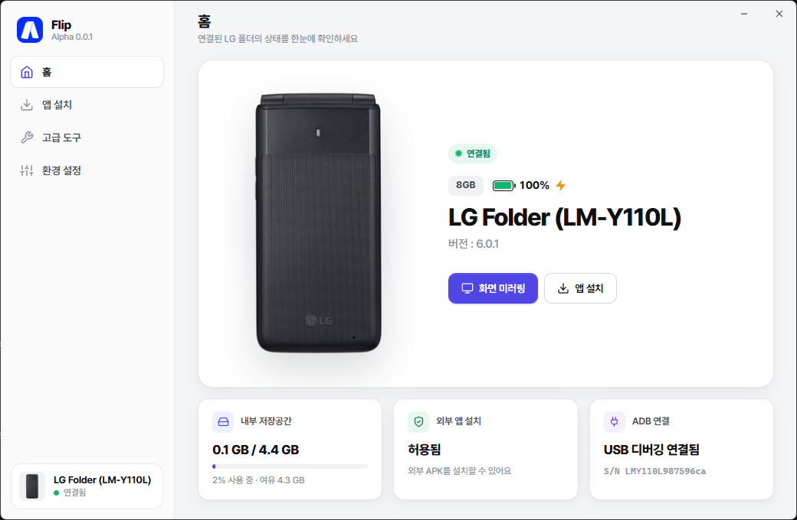

<!-- logo -->

# Flip - LG 폴더를 다시, 위대하게.

**LG 폴더 사용자들을 위한 차세대 커스텀 툴**

[-0078D4?style=flat)](#설치-방법)

---

## 소개

  

**Flip**은 **LG 폴더 1세대(`LM-Y110`)** 및 **LG 폴더 2세대(`LM-Y120`)** 사용자를 위해 개발된 차세대 올인원 커스텀 유틸리티입니다.

기존에는 외부 앱 하나를 설치하거나 가상 마우스를 세팅하려 해도 LG 드라이버를 따로 찾고, 명령 프롬프트(CMD)에서 긴 ADB 명령어를 직접 입력해야 하는 번거로움이 있었습니다. **Flip**은 **ADB · Scrcpy · LG 모바일 드라이버**를 하나의 설치 파일에 모두 내장하여, 컴퓨터에 익숙하지 않은 사용자도 직관적인 화면에서 모든 설정과 편의 기능을 바로 사용할 수 있도록 설계되었습니다.

> 현재 **알파(Alpha)** 버전 테스트 단계이며, 프로그램 내부의 **자동 업데이트** 기능을 통해 새로운 기능과 개선 사항을 계속 받아보실 수 있습니다.

---

## 주요 기능

- 원클릭 외부 앱 설치 준비 및 5단계 연결 가이드
- 드래그 앤 드롭 APK 설치 및 필수 추천 앱 설치
- 실시간 화면 미러링 및 가상 마우스 자동 세팅
- 화면 캡처 및 동영상 녹화 (사이드바 하단 빠른 툴바 지원)
- Wi-Fi 무선 연결 모드
- 문자(SMS) · 인증번호 실시간 알림 및 빠른 답장
- PC ↔ LG 폴더 간 양방향 파일 전송
- 화면 해상도 · 배율(DPI) 변경
- 벨소리 · 알림음 변경기
- SD카드 내부 저장소 확장
- 내장 ADB 쉘 콘솔
- 자동 업데이트 기능

---

## 설치 방법

1. [**Flip 릴리스 페이지**](https://github.com/FlipToolsKR/Flip/releases)로 이동합니다.
2. 최신 버전의 **`Flip_Setup.exe`** 파일을 다운로드하여 실행합니다.
3. 설치 마법사 안내에 따라 설치를 완료한 뒤 **Flip**을 실행합니다.

> **설치 및 연결 시 참고해 주세요**
> - **LG 드라이버 설치 대기**: 설치 도중 LG 모바일 USB 드라이버 단계에서 진행 바가 잠시 멈춘 것처럼 보일 수 있습니다. 드라이버 용량이 커서 백그라운드 설치에 시간이 걸리는 정상 과정이니 창을 닫지 말고 잠시만 기다려 주세요.
> - **Windows 보호 창 안내**: 실행 시 Windows의 PC 보호(SmartScreen) 창이 나타나면 **[추가 정보] → [실행]**을 눌러 진행하시면 됩니다.
> - **USB 디버깅 허용 창이 안 뜰 때**: 케이블 연결 후 휴대폰에 허용 팝업이 뜨지 않는다면, 휴대폰 상단 **알림창 → USB 연결 방식 → 사진 보내기(PTP)**로 변경해 주세요.

---

## 커뮤니티 및 피드백

- [**LG 폴더 사용자 모임 - 네이버 카페**](https://cafe.naver.com/luckyvenusfolder)
- 사용 중 발견한 오류나 추가되었으면 하는 기능은 [GitHub Issues](https://github.com/FlipToolsKR/Flip/issues)에 남겨주세요.

---

## 라이선스 및 오픈소스 고지

이 프로젝트는 [**GNU General Public License v3.0 (GPL-3.0)**](LICENSE) 라이선스 하에 배포됩니다.  
누구나 자유롭게 사용·연구·수정·기여할 수 있으며, 본 프로젝트의 코드를 수정하거나 파생 저작물을 배포할 경우 동일한 GPL-3.0 라이선스로 소스코드를 공개해야 합니다.

### 포함된 제3자 소프트웨어
- **Android Platform Tools (ADB)** — Apache License 2.0
- [**Scrcpy**](https://github.com/genymobile/scrcpy) — Apache License 2.0 (FFmpeg / libusb LGPL, SDL2 zlib)
- **Pretendard** — SIL Open Font License 1.1
- **LG Mobile USB Driver** — Copyright © LG Electronics Inc.
