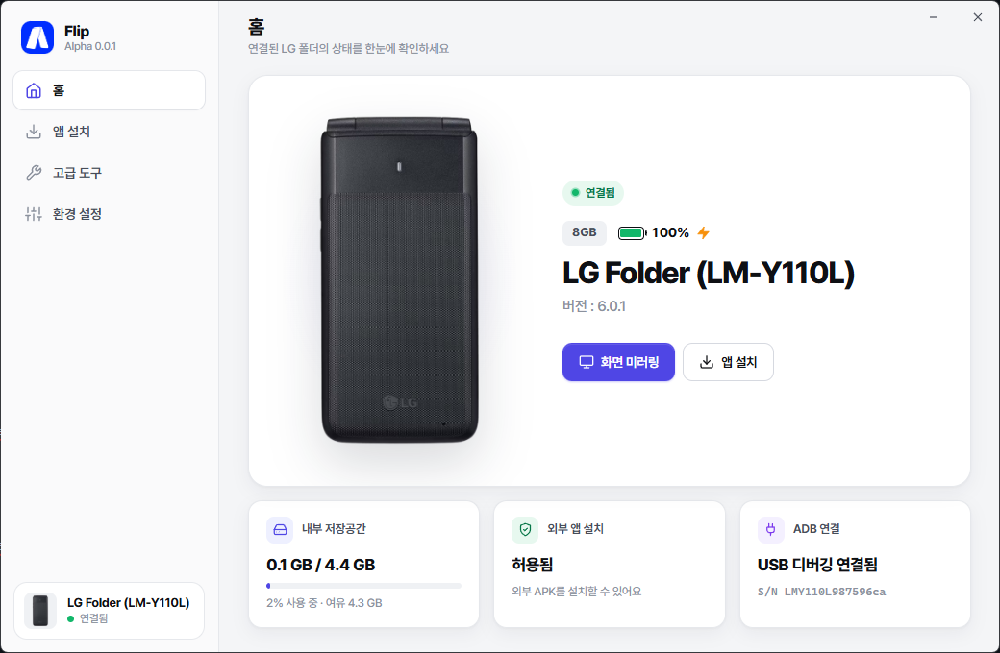

<!-- logo -->

# Flip - LG 폴더를 다시, 위대하게.

 

 

## 소개

  
**Flip**은 LG 폴더 1, 2 사용자들을 위한 차세대 커스텀 툴입니다.  
현재 알파 버전 테스트 단계입니다.

## 설치

1. [Flip 릴리즈](https://github.com/FlipToolsKR/Flip/releases)에 들어갑니다.
2. **Flip_Setup.exe** 파일을 다운로드합니다.
3. 실행 후 설치합니다.
* LG 드라이버 설치 시 멈춘 게 아닌 드라이버 크기가 커서 오래 걸리는 것입니다. 잠시만 기다려주세요. *

## 도움을 주신 분들

* [LG 폴더 사용자 모임 - 네이버 카페](https://cafe.naver.com/luckyvenusfolder)
